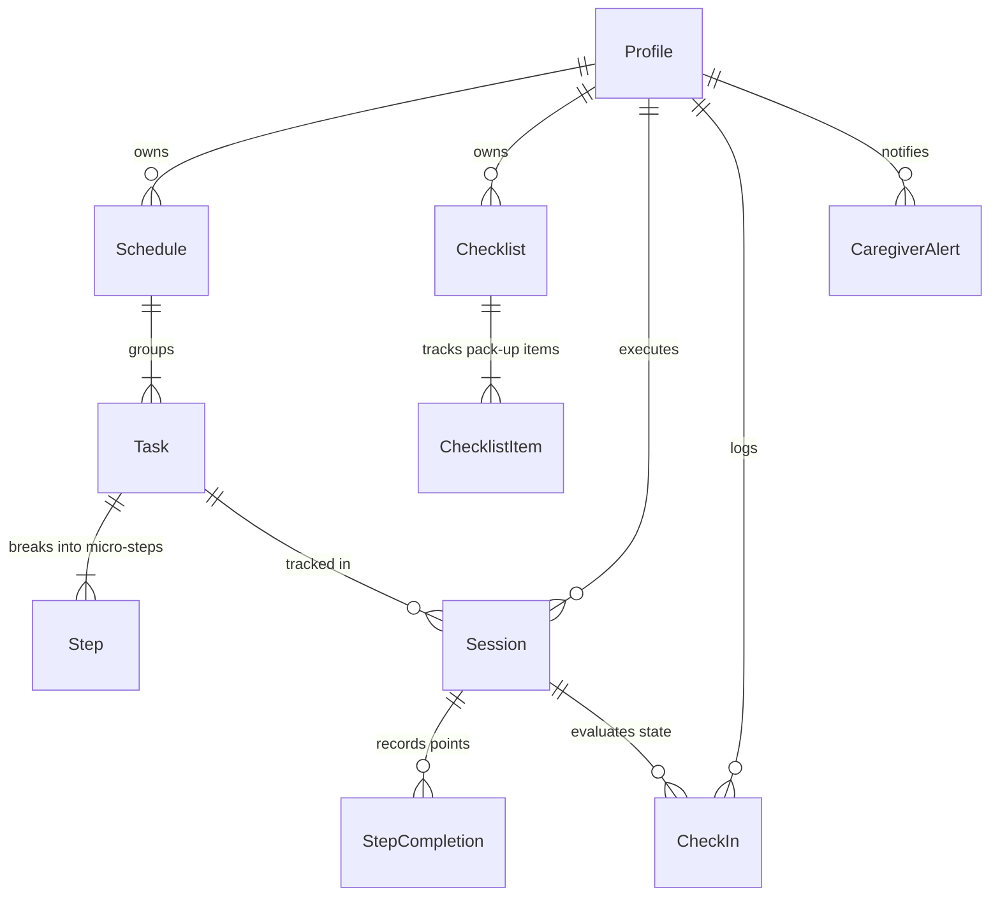
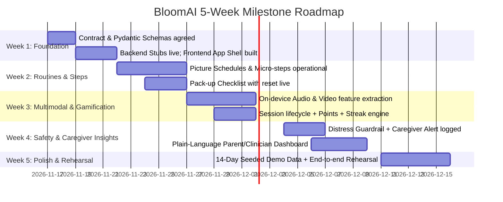

# BloomAI Prototype Implementation Plan & System Specification
**Project:** BloomAI — AI Companion for Children with ADHD  
**Course / Submission:** 5-Week Capstone / Prototype Delivery  
**Core Stack:** FastAPI, SQLite, SQLAlchemy 2.0, Pydantic v2, React + Vite + Tailwind, Recharts

---

## 1. Executive Alignment: Sir's Instructions vs. Prototype Plan

### Sir's Core Directive:
> *"BloomAI is an AI companion for children with ADHD that uses text, audio and on-device video check-ins to spot focus, forgetfulness and emotional-regulation patterns. It then creates personalised support for each child: picture schedules, micro-steps, timers, pack-up checklists and instant praise. Parents, teachers and clinicians get plain-language insights, with safety guardrails that pause coaching and alert a caregiver when distress is detected."*

### Key Enhancements & Adjustments to Align with Sir's Instructions:

| Capability in Sir's Prompt | Initial Prototype Plan | Problem / Gap | Solution & Architecture in Revised Plan |
| :--- | :--- | :--- | :--- |
| **1. On-device Video Check-ins** | Excluded completely ("Text & audio only"). | Violates Sir's core multimodal requirement. | **On-device Camera Check-in:** Browser captures webcam locally using HTML5 `<video>` / canvas; extracts on-device fidgeting/movement score and face presence. **Zero video is ever stored or transmitted to backend** (strict child privacy). Backend schema accepts extracted `video_features: { fidget_score, face_present }`. |
| **2. Plain-Language Insights for Parents, Teachers, Clinicians** | Replaced with child-only "My Progress" page (stars & streaks). | Evaluators/clinicians will find no stakeholder insights. | **Dedicated Caregiver Insights Dashboard (`/caregiver`):** Accessible via a simple pin/toggle. Provides plain-language narrative reports: *"Aarav's focus peaks in 10-minute bursts before restlessness increases; forgetfulness on pack-up checklists dropped 40% after visual reminders."* |
| **3. Caregiver Alert on Distress** | Paused coaching and showed helpline only to the child. | Sir specified: *"alert a caregiver when distress is detected"*. | **Dual-Action Safety Guardrail:** When distress is detected, the app pauses coaching and shows the child the trusted-adult screen **AND** logs a prominent high-priority `CaregiverAlert` with timestamp and trigger context in the Caregiver Insights view. |
| **4. Spotting ADHD Patterns (Focus, Forgetfulness, Emotional Regulation)** | Simple mood score only. | Lacked detection of *forgetfulness* and specific ADHD behavioral markers. | **Tri-Domain Pattern Analysis:**<br>1. **Focus:** Task duration vs. expected time + video fidget index.<br>2. **Forgetfulness:** Checklist completion rate and time-to-pack.<br>3. **Emotional Regulation:** Check-in sentiment, audio agitation, and recovery time after calm breaks. |
| **5. Personalised Support Generation** | Fixed manual preset templates only. | Sir specified: *"creates personalised support for each child"*. | **Pattern-Driven Recommendation Engine:** Backend analyzes child's recent sessions and generates tailored recommendations: suggested task time caps (e.g., *"Break 15m homework into two 7m micro-steps with a movement break"*), plus an optional AI Micro-step generator. |

---

## 2. System Architecture & Repository Partitioning

The repository maintains strict workspace separation to ensure zero merge conflicts:

```
BloomAI/
├── backend/                  # [OWNED BY MEMBER A: Backend Lead]
│   ├── app/
│   │   ├── main.py           # FastAPI entrypoint, middleware, routers
│   │   ├── config.py         # App configuration & CORS settings
│   │   ├── database.py       # SQLite engine & session maker
│   │   ├── models/           # SQLAlchemy DB models (Profile, Schedule, Checklist, Session, CheckIn, CaregiverAlert)
│   │   ├── schemas/          # Pydantic v2 schemas (includes video_features & caregiver insights)
│   │   ├── routers/          # API endpoints (Profile, Schedules, Checklists, Sessions, Checkins, Caregiver, Safety, AI)
│   │   ├── scoring/          # ADHD tri-domain scoring (Focus, Emotion, Forgetfulness)
│   │   └── safety/           # Distress rules, caregiver alert logger & helplines
│   ├── seed/                 # Preset schedules, ADHD checklists, and 14-day demo dataset
│   ├── tests/                # Automated pytest suite (100% endpoint coverage)
│   ├── Dockerfile
│   └── README.md
│
├── frontend/                 # [OWNED BY MEMBER B: Child Experience & Caregiver View]
│   ├── src/
│   │   ├── pages/            # Child Home, Routine Runner, Checklist, Calm-down, SafeMode, CaregiverInsights
│   │   ├── components/       # Visual timers, reward animations, big-button child UI, on-device camera preview
│   │   ├── api/client.ts     # Centralized API client
│   │   └── theme/            # Calm color palette, high contrast, ADHD-friendly UI
│   └── package.json
│
├── ai/                       # [OWNED BY MEMBER C: Multimodal Check-ins & AI Insights]
│   ├── prompts/              # Effort-based praise rules, calm coaching, plain-language caregiver report prompts
│   ├── fallback_templates/   # Offline fallback messages & templates (works without API keys)
│   ├── llm_service.py        # Praise generator, calm coach, and clinical plain-language synthesizer
│   └── client_vision/        # On-device browser motion & fidget detection helpers
│
└── docs/                     # [SHARED ACROSS ALL MEMBERS]
    ├── api-contract.md       # Canonical endpoint specification
    └── architecture.md
```

---

## 3. Database Schema & ADHD Data Models



### Key Data Entities:
1. **`profiles`**: Single child profile (`id=1`, `name`, `avatar`, `favourite_rewards`, `adhd_focus_target_minutes`).
2. **`schedules` & `tasks` & `steps`**: Picture schedule hierarchies with icons, expected seconds, and visual micro-steps.
3. **`checklists` & `checklist_items`**: Forgetfulness tracking with pack-up reminder times and reset capabilities.
4. **`sessions` & `step_completions`**: Real-time task pacing, micro-step completion timestamps, and gamified points (+5 per step, +10 bonus on completion).
5. **`checkins`**: Multimodal records storing:
   - **Text:** Optional child notes.
   - **Emoji:** `happy`, `calm`, `tired`, `sad`, `worried`, `angry`.
   - **Audio features:** `avg_volume`, `peak_volume`, `words_per_minute`, `duration_seconds` (no raw audio stored).
   - **Video features (on-device):** `fidget_score` (0.0–1.0 motion intensity), `face_present` (boolean), `duration_seconds` (zero raw video stored).
   - **Derived metrics:** `focus_score` (0–100), `emotion_score` (0–100), `label` (`flow`, `focused`, `calm`, `tired`, `frustrated`, `distressed`), `safe_mode` (boolean).
6. **`caregiver_alerts`**: Logged whenever distress is triggered (`id`, `checkin_id`, `trigger_phrase`, `emotion_score`, `created_at`, `is_acknowledged`).
7. **`user_stats`**: Gamified progress (`total_points`, `current_streak`, `best_streak`, `last_active_date`).

---

## 4. Work Breakdown by Member

### Member A: Backend Lead
**Core Scope:** FastAPI, Database, Tri-Domain Scoring, Safety & Caregiver Alert System, Personalised Support Recommendations.

- **Week 1 (Foundation & Contract):**
  - Scaffold FastAPI app, SQLite database, Pydantic v2 schemas.
  - Deliver canonical `docs/api-contract.md` including video features and caregiver endpoints.
  - Implement stub routers so Frontend and AI members can begin integration immediately.
- **Week 2 (Core Entities & Micro-steps):**
  - Deliver Profile CRUD and Template instantiation (Morning Routine, Homework Focus, Bedtime Calm).
  - Deliver Schedule, Task, and Micro-step CRUD, with reordering.
  - Deliver Checklist CRUD with item reset and completion logging.
  - Deliver Session lifecycle: start task, complete micro-step (+5 points), end task (+10 points).
- **Week 3 (Multimodal Check-ins & Tri-Domain Scoring):**
  - Build `POST /api/checkins` storing emoji, text sentiment, audio features, and on-device video fidget features.
  - Implement ADHD scoring formula combining task pacing, speech agitation, and video restlessness.
  - Build forgetfulness tracking (calculating pack-up checklist compliance rate).
- **Week 4 (Distress Safety, Caregiver Alerts & Insights):**
  - Implement distress rule: instant trigger on self-critical phrases + compound low-score trigger.
  - Build `CaregiverAlert` persistence: when distress trips, log alert for caregiver review while setting `safe_mode=True`.
  - Implement `GET /api/caregiver/insights`: Computes plain-language pattern summaries for parents, teachers, and clinicians (focus drop-off points, forgetfulness rates, emotion trends).
  - Implement `GET /api/support/recommendations`: Recommends adaptive micro-step durations based on child's focus patterns.
- **Week 5 (Verification, Demo Seed & Docker):**
  - Build `POST /api/dev/seed-demo` seeding 14 days of realistic ADHD pattern data (including the 12-minute focus dip demo story).
  - Containerize backend via `Dockerfile`.
  - Comprehensive Pytest test suite covering all endpoints, distress rules, and caregiver reports.

---

### Member B: Frontend Lead (Child Experience & Caregiver View)
**Core Scope:** React, Vite, Tailwind child-friendly UI, Visual schedules, Timers, Gamification, and Caregiver Insights page.

- **Week 1 (Design System & App Shell):**
  - Setup Vite + React + Tailwind with ADHD-friendly design system (large touch targets, calm color palette, minimal text, high contrast).
  - Build first-launch child profile setup (avatar selection, reward preferences).
  - Setup centralized API client (`api/client.ts`) with mock/real toggle.
- **Week 2 (Picture Schedules & Micro-steps):**
  - Implement Picture Schedule screen with color coding and visual icons.
  - Build One-Step-at-a-Time Micro-step view (large single-step cards to eliminate ADHD cognitive overwhelm).
  - Build Never-Forget Checklist screen with satisfying checkbox animations and pack-up reminder time display.
- **Week 3 (Transitions, Visual Timers & Rewards):**
  - Build visual transition countdown timer (pie or progress bar countdown for routine transitions).
  - Implement instant celebration modal with reward animations (confetti/stars), points counter (+5 step, +10 task), and sound effects (with mute option).
  - Hook session execution flow: Start $\rightarrow$ Step Complete $\rightarrow$ Praise $\rightarrow$ End Session.
- **Week 4 (Calm-down Breaks & Caregiver Dashboard):**
  - Build Calm-down screen featuring guided breathing bubble animation and movement break prompts.
  - Build Safe-Mode screen: displays gentle "Talk to a trusted adult" reassurance and helpline cards when `safe_mode=True`.
  - Build **Caregiver Insights Dashboard (`/caregiver`)**:
    - Focus endurance graph (Recharts).
    - Forgetfulness rate on checklists.
    - Plain-language narrative summary card for parents and clinicians.
    - Active Caregiver Distress Alert banner.
- **Week 5 (Accessibility, Usability & Polish):**
  - Responsive audit for tablet and desktop display.
  - Accessibility audit (WCAG contrast, keyboard navigation, clear font sizing).
  - Rehearse end-to-end demo flow.

---

### Member C: AI, Multimodal Check-ins & Insights Lead
**Core Scope:** On-device Browser Feature Extraction, Effort-Based Praise, Calm Coaching, Plain-Language Insight Generation.

- **Week 1 (AI Rules & Tone Standards):**
  - Author `docs/ai-rules.md`: rules for child praise (effort-based, non-judgmental, never shaming, no medical claims).
  - Build fallback JSON template catalog for praise and calm coaching (guaranteeing offline zero-API-key functionality).
- **Week 2 (Check-in Interface & Praise Engine):**
  - Build child Check-in UI: intuitive emoji mood selector and short text input.
  - Implement `generate_praise(context)` LLM wrapper with blocked-words safety filter, timeout, and immediate fallback template selection.
- **Week 3 (Multimodal On-device Feature Extraction):**
  - **Audio feature extractor:** Capture browser microphone using Web Audio API to measure `avg_volume` and `peak_volume`; count words via Web Speech API to compute `words_per_minute`.
  - **On-device video check-in:** Capture webcam preview on-device using HTML5 canvas difference / simple motion estimation to compute `fidget_score` (0.0 to 1.0) and face presence.
  - **Privacy Guarantee:** Enforce client-side feature reduction; send only extracted numbers to Member A's check-in endpoint; ensure raw audio/video streams are discarded immediately.
- **Week 4 (Plain-Language Caregiver Report Generation):**
  - Build `generate_caregiver_report(metrics)` prompt that transforms raw task times, checklist scores, and mood frequencies into plain-language clinical insights:
    - Example: *"Aarav engages best with visual homework routines under 10 minutes. Around minute 12, fidget activity increases, suggesting micro-steps should be capped at 8 minutes."*
  - Integrate calm coaching reply following check-in submissions.
- **Week 5 (Safety Review & Demo Scenarios):**
  - Safety validation pass: review sample generated outputs to ensure compliance with ADHD behavioral guidelines.
  - Prepare 3 concrete presentation demo scenarios:
    1. *Smooth Morning Routine:* Child completes steps, earns points, receives instant praise.
    2. *Homework Fatigue & Focus Dip:* Child experiences restlessness at 12 minutes, check-in prompts a 2-minute movement break.
    3. *Distress Safety & Caregiver Alert:* Self-critical input triggers Safe-Mode for child and logs alert for caregiver.

---

## 5. Timeline & Milestone Synchronization



---

## 6. Detailed API Specification (Updated)

### 6.1 Multimodal Check-in
- **`POST /api/checkins`**
  - Request:
    ```json
    {
      "session_id": 5,
      "emoji": "tired",
      "text": "Math was hard today",
      "audio_features": {
        "avg_volume": 0.45,
        "peak_volume": 0.72,
        "words_per_minute": 130.0,
        "duration_seconds": 6.0
      },
      "video_features": {
        "fidget_score": 0.65,
        "face_present": true,
        "duration_seconds": 5.0
      }
    }
    ```
  - Response `201`:
    ```json
    {
      "id": 1,
      "focus_score": 48,
      "emotion_score": 52,
      "label": "tired",
      "safe_mode": false,
      "created_at": "2026-11-19T18:00:00Z"
    }
    ```

### 6.2 Caregiver Plain-Language Insights
- **`GET /api/caregiver/insights?days=7`**
  - Response `200`:
    ```json
    {
      "child_name": "Aarav",
      "time_range_days": 7,
      "focus_pattern": {
        "avg_focus_score": 68,
        "optimal_task_duration_minutes": 10,
        "restlessness_onset_minutes": 12,
        "summary": "Focus remains steady during visual morning routines but shows increased fidgeting past 12 minutes in written homework."
      },
      "forgetfulness_pattern": {
        "checklist_completion_rate": 86,
        "most_forgotten_items": ["Water bottle (filled)", "Math notebook"],
        "summary": "Forgetfulness has decreased 25% following visual pack-up reminders at 07:45."
      },
      "emotional_regulation": {
        "dominant_mood": "calm",
        "calm_recovery_rate": 92,
        "summary": "Responds positively to 2-minute movement breaks when frustration is detected."
      },
      "clinical_summary": "Aarav demonstrates strong task engagement with short, visual micro-steps. Recommending continuing 10-minute caps on sedentary tasks.",
      "active_alerts_count": 0
    }
    ```

### 6.3 Caregiver Distress Alerts
- **`GET /api/caregiver/alerts`**
  - Response `200`:
    ```json
    [
      {
        "id": 1,
        "created_at": "2026-11-19T16:30:00Z",
        "trigger_text": "I hate myself and can't do this",
        "emotion_score": 18,
        "is_acknowledged": false
      }
    ]
    ```
- **`POST /api/caregiver/alerts/{id}/acknowledge`**: Marks alert as reviewed by caregiver.

### 6.4 Adaptive Personalised Recommendations
- **`GET /api/support/recommendations`**
  - Response `200`:
    ```json
    {
      "recommended_max_task_seconds": 600,
      "suggested_micro_break_seconds": 120,
      "recommendations": [
        "Cap homework focus sessions at 10 minutes to prevent restlessness.",
        "Insert a 2-minute movement break between math and reading steps.",
        "Schedule backpack pack-up at 07:45 before morning screen time."
      ]
    }
    ```

---

## 7. Demo Day Presentation Strategy

To demonstrate all of Sir's requirements within a 10-minute presentation:
1. **Show Child Flow (3 mins):** Member B logs in as Aarav $\rightarrow$ picks Morning Routine $\rightarrow$ completes "Brush teeth" micro-step $\rightarrow$ instant stars and praise animation $\rightarrow$ checks off backpack items.
2. **Show Multimodal Check-in & Restlessness Detection (3 mins):** Simulate homework check-in with high fidgeting / tired voice note $\rightarrow$ Focus + Emotion scoring updates $\rightarrow$ child receives calm-down breathing prompt.
3. **Show Distress Safety Guardrail (2 mins):** Type self-critical statement $\rightarrow$ system immediately enters Safe-Mode, locks task, and displays helpline information for the child.
4. **Show Caregiver & Clinician Insights Dashboard (2 mins):** Switch to Caregiver View $\rightarrow$ demonstrate plain-language ADHD pattern synthesis (focus fatigue at 12 minutes, forgetfulness reduction) and show the logged caregiver distress notification.
