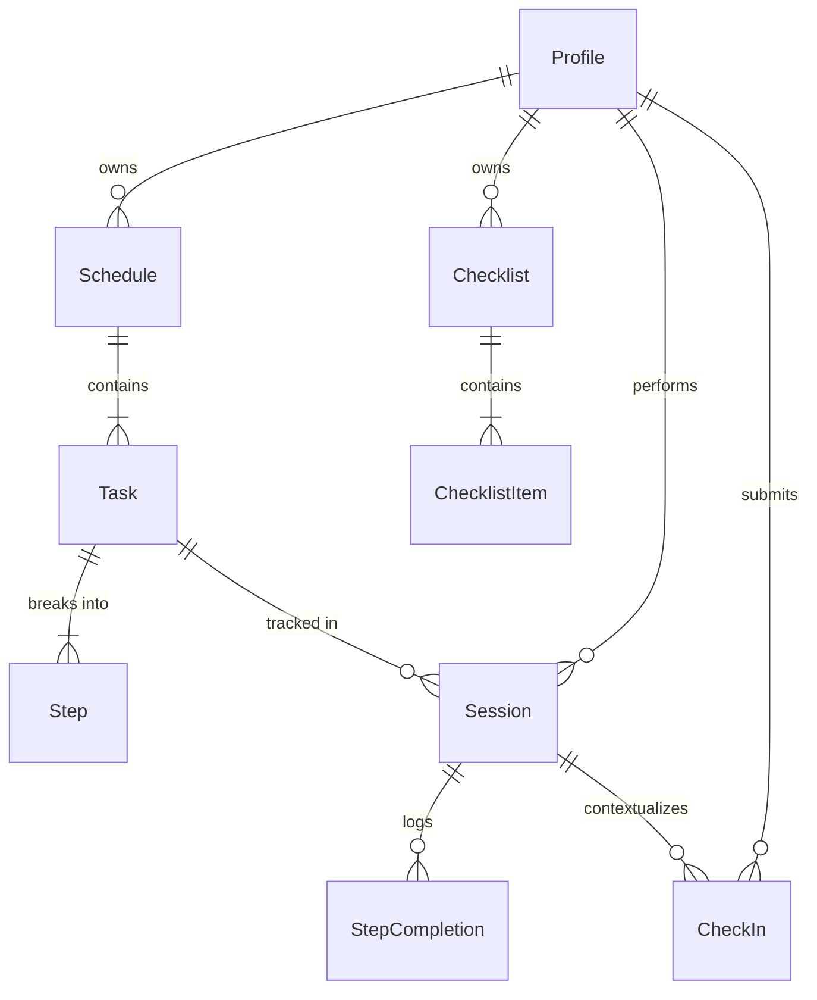

# BloomAI Backend Implementation Plan & Commit Roadmap
**Role:** Member A (Backend Lead: FastAPI, Database, Scoring & Safety Rules)  
**Target Duration:** 5 Weeks (25 Working Days)  
**Tech Stack:** Python 3.10+, FastAPI, SQLite, SQLAlchemy 2.0, Pydantic v2, Pytest

---

## 1. System Architecture & Repository Structure

To ensure zero merge conflicts between **Member A (Backend)**, **Member B (Child UI Frontend)**, and **Member C (AI & Check-ins)**, the repository is partitioned into 3 isolated top-level application workspaces plus a shared `docs/` workspace.

```
BloomAI/
├── backend/                  # [OWNED BY MEMBER A]
│   ├── app/
│   │   ├── __init__.py
│   │   ├── main.py           # FastAPI entrypoint, middleware, router mounts
│   │   ├── config.py         # App settings, paths, CORS config
│   │   ├── database.py       # SQLite engine, session maker, Base declarative
│   │   ├── models/           # SQLAlchemy DB models
│   │   │   ├── __init__.py
│   │   │   ├── profile.py
│   │   │   ├── schedule.py
│   │   │   ├── checklist.py
│   │   │   ├── session.py
│   │   │   └── checkin.py
│   │   ├── schemas/          # Pydantic request & response schemas
│   │   │   ├── __init__.py
│   │   │   ├── profile.py
│   │   │   ├── schedule.py
│   │   │   ├── checklist.py
│   │   │   ├── session.py
│   │   │   ├── checkin.py
│   │   │   ├── progress.py
│   │   │   └── safety.py
│   │   ├── routers/          # FastAPI APIRouters
│   │   │   ├── __init__.py
│   │   │   ├── health.py
│   │   │   ├── profile.py
│   │   │   ├── templates.py
│   │   │   ├── schedules.py
│   │   │   ├── checklists.py
│   │   │   ├── sessions.py
│   │   │   ├── checkins.py
│   │   │   ├── safety.py
│   │   │   ├── progress.py
│   │   │   └── dev.py
│   │   ├── scoring/          # Rule-based scoring engine
│   │   │   ├── __init__.py
│   │   │   ├── formula.py
│   │   │   └── sentiment_lexicon.py
│   │   └── safety/           # Distress detection & safety guardrails
│   │       ├── __init__.py
│   │       ├── distress_detector.py
│   │       └── helplines.json
│   ├── seed/
│   │   ├── __init__.py
│   │   ├── presets.py        # Morning, Homework, Bedtime templates
│   │   └── seed_db.py        # Seed script for initial presets & demo data
│   ├── tests/                # Automated pytest suite
│   │   ├── conftest.py
│   │   ├── test_health.py
│   │   ├── test_schedules.py
│   │   ├── test_checklists.py
│   │   ├── test_sessions.py
│   │   ├── test_scoring.py
│   │   ├── test_safety.py
│   │   └── test_progress.py
│   ├── requirements.txt
│   ├── Dockerfile
│   └── README.md
│
├── frontend/                 # [OWNED BY MEMBER B & C]
│   ├── src/                  # React + Vite + Tailwind child UI
│   ├── package.json
│   └── ...
│
├── ai/                       # [OWNED BY MEMBER C]
│   ├── prompts/              # Effort-based praise & calm-down prompts
│   ├── fallback_templates/   # Static fallback responses for offline mode
│   ├── llm_service.py        # LLM praise & calm-reply generator wrapper
│   └── tests/
│
└── docs/                     # [SHARED ACROSS ALL MEMBERS]
    ├── api-contract.md       # Canonical endpoint & payload specification
    └── architecture.md
```

### Module Boundary Rules
1. **Member A (Backend)** owns everything inside `backend/` and `docs/api-contract.md`.
2. **Member B (Frontend)** consumes `http://localhost:8000/api` endpoints and tests against Swagger `/docs` or the stub responses.
3. **Member C (AI & Check-ins)** writes the AI prompt engineering and LLM service inside `ai/`. When backend exposes `/api/praise` and `/api/calm-reply`, backend routers cleanly import from `ai.llm_service` (or use internal fallback routing if the service is standalone).

---

## 2. Database Models (SQLite + SQLAlchemy 2.0)

Member A manages the single-child SQLite database (`bloom.db`). All datetime fields use UTC ISO-8601 formatting.



### Database Tables:
1. **`profiles`**: `id` (PK, Int=1), `name` (String), `avatar` (String), `favourite_rewards` (JSON String list), `created_at` (DateTime), `updated_at` (DateTime).
2. **`templates`**: `id` (PK), `type` ("schedule" | "checklist"), `name` (String), `icon` (String), `color` (String), `data` (JSON).
3. **`schedules`**: `id` (PK), `name` (String), `color` (String), `icon` (String), `created_at` (DateTime).
4. **`tasks`**: `id` (PK), `schedule_id` (FK -> schedules.id), `title` (String), `icon` (String), `order` (Int), `expected_seconds` (Int).
5. **`steps`**: `id` (PK), `task_id` (FK -> tasks.id), `text` (String), `icon` (String), `order` (Int).
6. **`checklists`**: `id` (PK), `name` (String), `reminder_time` (String, e.g. "07:45"), `created_at` (DateTime).
7. **`checklist_items`**: `id` (PK), `checklist_id` (FK -> checklists.id), `text` (String), `icon` (String), `is_checked` (Boolean), `order` (Int).
8. **`sessions`**: `id` (PK), `task_id` (FK -> tasks.id), `started_at` (DateTime), `ended_at` (DateTime, Nullable), `duration_seconds` (Int, Nullable), `expected_seconds` (Int), `bonus_points` (Int, Default=0), `status` (String: "active" | "completed" | "abandoned").
9. **`step_completions`**: `id` (PK), `session_id` (FK -> sessions.id), `step_id` (FK -> steps.id), `completed_at` (DateTime), `points_awarded` (Int, Default=5).
10. **`checkins`**: `id` (PK), `session_id` (FK -> sessions.id, Nullable), `emoji` (String), `text` (String, Nullable), `avg_volume` (Float, Nullable), `peak_volume` (Float, Nullable), `words_per_minute` (Float, Nullable), `audio_duration_seconds` (Float, Nullable), `focus_score` (Int), `emotion_score` (Int), `label` (String), `safe_mode` (Boolean), `created_at` (DateTime).
11. **`user_stats`**: `id` (PK, Int=1), `total_points` (Int, Default=0), `current_streak` (Int, Default=0), `best_streak` (Int, Default=0), `last_active_date` (Date, Nullable).

---

## 3. Heuristic Rules & Scoring Formulas

### 3.1 Focus + Emotion Scoring Engine (`backend/app/scoring/formula.py`)
Both scores are bounded integers between `0` and `100`.

#### Emotion Score Formula:
$$\text{Emotion Score} = \text{clamp}\Big( \text{BaseEmoji} + \Delta\text{Sentiment} + \Delta\text{Acoustic}, 0, 100 \Big)$$

1. **Base Emoji Weight:**
   - `"calm"`: 90
   - `"happy"`: 85
   - `"tired"`: 50
   - `"worried"`: 40
   - `"sad"`: 30
   - `"angry"`: 20
2. **Text Sentiment Adjustment ($\Delta\text{Sentiment}$):**
   - Positive words (`good`, `great`, `done`, `proud`, `fun`, `yay`, `finished`): $+5$ each (max $+15$)
   - Negative words (`hate`, `hard`, `tired`, `bored`, `angry`, `annoying`, `bad`): $-7$ each (max $-21$)
3. **Audio Agitation Adjustment ($\Delta\text{Acoustic}$):**
   - High volume agitation: if `avg_volume > 0.7` or `peak_volume > 0.85`: $-10$
   - Rapid speech pace: if `words_per_minute > 160`: $-10$
   - Calm, steady voice: if `0.2 <= avg_volume <= 0.5` and `90 <= words_per_minute <= 130`: $+5$

#### Focus Score Formula:
$$\text{Focus Score} = \text{clamp}\Big( \text{BaseFocus} \times \text{PacingMultiplier} + \Delta\text{EmotionFactor}, 0, 100 \Big)$$

1. **Base Focus:** Starts at 75.
2. **Pacing Multiplier (Task Duration vs. Expected Duration):**
   - Let $R = \frac{\text{duration\_seconds}}{\text{expected\_seconds}}$
   - If $0.7 \le R \le 1.25$: On-track pacing, multiplier = $1.15$ ($+10$ to $+15$ pts)
   - If $1.25 < R \le 2.0$: Mild distraction/delay, multiplier = $0.85$ ($-10$ pts)
   - If $R > 2.0$: Significant off-task wandering, multiplier = $0.65$ ($-25$ pts)
   - If no active session ($R = 1.0$ default): neutral multiplier = $1.0$
3. **Emotion Factor:**
   - If Emotion Score $> 70$: $+10$ focus boost
   - If Emotion Score $< 40$: $-15$ focus penalty
4. **Label Categorization:**
   - `emotion_score >= 70` & `focus_score >= 70` $\rightarrow$ `"flow"`
   - `focus_score >= 65` $\rightarrow$ `"focused"`
   - `emotion_score >= 60` & `focus_score < 65` $\rightarrow$ `"calm"`
   - `emoji == "tired"` or `focus_score < 40` $\rightarrow$ `"tired"`
   - `emotion_score < 40` $\rightarrow$ `"frustrated"`
   - `safe_mode == True` $\rightarrow$ `"distressed"`

### 3.2 Distress Safety Guardrail (`backend/app/safety/distress_detector.py`)
Evaluates text and emotional triggers. If tripped, `safe_mode = True`, triggering the frontend to immediately pause task coaching and display the helpline / trusted adult screen.

#### Triggers for `safe_mode = True`:
1. **Explicit Distress Keyword Match (Instant Trigger regardless of score):**
   - Phrases: `hate myself`, `want to disappear`, `kill myself`, `hurt myself`, `i am stupid`, `i am dumb`, `i am worthless`, `nobody likes me`, `i want to cry`, `can't do anything right`, `punish me`.
2. **Compound Low-Score Trigger:**
   - `emotion_score <= 25` **AND** contains severe frustration terms (`hate this`, `give up`, `hate everything`, `can't do it`, `leave me alone`).

---

## 4. Week-by-Week Implementation & Commit Roadmap

```mermaid
gantt
    title Member A (Backend) 5-Week Commit Timeline
    dateFormat  YYYY-MM-DD
    section Week 1: Foundation & Stubs
    A1 chore: init FastAPI, CORS, health          :a1, 2026-11-17, 1d
    A2 docs: api-contract.md & Pydantic schemas  :a2, after a1, 1d
    A3 feat: stub routers for all endpoints      :a3, after a2, 1d
    A4 feat: SQLAlchemy models & DB setup        :a4, after a3, 1d
    A5 feat: seed templates & presets            :a5, after a4, 1d
    section Week 2: Core Entities & Sessions
    A6 feat: real profile endpoints              :a6, after a5, 1d
    A7 feat: schedule, task & step CRUD          :a7, after a6, 2d
    A8 feat: checklist CRUD & item reset         :a8, after a7, 1d
    A9 feat: session start, step complete, end   :a9, after a8, 1d
    section Week 3: Check-ins, Scoring, Points
    A10 feat: check-in storage endpoint          :a10, after a9, 2d
    A11 feat: Focus + Emotion scoring module     :a11, after a10, 2d
    A12 feat: points & streak calculation        :a12, after a11, 1d
    section Week 4: Safety & Progress
    A13 feat: distress rule & safe-mode flag     :a13, after a12, 1d
    A14 feat: safety resources endpoint          :a14, after a13, 1d
    A15 feat: progress summary & mood-by-day     :a15, after a14, 2d
    section Week 5: Polish & Deployment
    A16 test: API test suite & error handling    :a16, after a15, 2d
    A17 feat: demo seed endpoint (2-week data)   :a17, after a16, 1d
    A18 chore: Dockerfile & backend README       :a18, after a17, 1d
    A19 fix: demo day bug fixes & polish         :a19, after a18, 1d
```

---

### WEEK 1: Foundation, API Contract & Stubs

#### Commit A1 (W1 D1)
- **Commit Message:** `chore: init FastAPI project, config, CORS, /api/health`
- **Goal:** Set up the backend folder structure, virtual environment configuration, CORS for the React frontend, and a working health check.
- **Files to Create:**
  - `backend/requirements.txt`:
    ```
    fastapi==0.110.0
    uvicorn==0.28.0
    sqlalchemy==2.0.28
    pydantic==2.6.4
    pytest==8.1.1
    httpx==0.27.0
    ```
  - `backend/app/config.py`:
    Define `Settings` (app title, SQLite URL `sqlite:///./bloom.db`, allowed CORS origins: `["http://localhost:5173", "http://localhost:3000"]`).
  - `backend/app/main.py`:
    Initialize FastAPI app, add `CORSMiddleware`, mount `/api/health`.
  - `backend/app/routers/health.py`:
    `GET /api/health` returning `{"status": "ok", "app": "BloomAI Backend", "version": "0.1.0"}`.
- **Validation:**
  ```powershell
  cd backend
  uvicorn app.main:app --reload --port 8000
  Invoke-RestMethod -Uri http://localhost:8000/api/health
  ```
- **Git Command:**
  ```bash
  git checkout -b feat/backend-skeleton
  git add backend/
  git commit -m "chore: init FastAPI project, config, CORS, /api/health"
  ```

---

#### Commit A2 (W1 D2)
- **Commit Message:** `docs: add api-contract.md and Pydantic schemas`
- **Goal:** Codify the contract between Members A, B, and C in `docs/api-contract.md` and create matching Pydantic schemas in `backend/app/schemas/`.
- **Files to Create:**
  - `docs/api-contract.md`: Document exact JSON contracts for Profile, Schedules, Tasks, Steps, Checklists, Sessions, Check-ins, AI, Safety, Progress.
  - `backend/app/schemas/profile.py`: `ProfileCreate`, `ProfileUpdate`, `ProfileResponse`.
  - `backend/app/schemas/schedule.py`: `StepResponse`, `TaskResponse`, `ScheduleResponse`, `ScheduleCreate`, `TaskCreate`, `StepCreate`.
  - `backend/app/schemas/checklist.py`: `ChecklistItemResponse`, `ChecklistResponse`, `ChecklistCreate`, `ItemToggleRequest`.
  - `backend/app/schemas/session.py`: `SessionStartRequest`, `SessionStartResponse`, `StepCompleteResponse`, `SessionEndResponse`.
  - `backend/app/schemas/checkin.py`: `AudioFeatures`, `CheckInCreate`, `CheckInResponse`.
  - `backend/app/schemas/safety.py`: `ResourceItem`, `SafetyResourcesResponse`.
  - `backend/app/schemas/progress.py`: `ProgressSummaryResponse`, `MoodDayPoint`.
- **Validation:** Run Python import test to ensure all schemas validate cleanly with Pydantic v2.
- **Git Command:**
  ```bash
  git add docs/api-contract.md backend/app/schemas/
  git commit -m "docs: add api-contract.md and Pydantic schemas"
  ```

---

#### Commit A3 (W1 D3)
- **Commit Message:** `feat: stub routers returning example JSON for every endpoint`
- **Goal:** Unblock Member B and Member C immediately. Every single URL in the API contract must answer `200 OK` with realistic mock data.
- **Files to Create:**
  - `backend/app/routers/profile.py` (stub returning Aarav's profile)
  - `backend/app/routers/templates.py` (stub returning preset templates)
  - `backend/app/routers/schedules.py` (stub returning morning & homework schedules)
  - `backend/app/routers/checklists.py` (stub returning school bag checklist)
  - `backend/app/routers/sessions.py` (stub returning session 5, points awarded)
  - `backend/app/routers/checkins.py` (stub returning focus: 50, emotion: 40, safe_mode: false)
  - `backend/app/routers/safety.py` (stub returning helpline list)
  - `backend/app/routers/progress.py` (stub returning points: 55, streak: 3)
  - Mount all stub routers in `backend/app/main.py`.
- **Validation:** Open `http://localhost:8000/docs` in the browser and verify every endpoint executes and returns the schema data.
- **Git Command:**
  ```bash
  git add backend/app/routers/ backend/app/main.py
  git commit -m "feat: stub routers returning example JSON for every endpoint"
  ```

---

#### Commit A4 (W1 D4)
- **Commit Message:** `feat: SQLAlchemy models and session setup`
- **Goal:** Implement the database layer with SQLite and SQLAlchemy declarative models.
- **Files to Create:**
  - `backend/app/database.py`: `engine`, `SessionLocal`, `Base = declarative_base()`, `get_db()` dependency.
  - `backend/app/models/profile.py`: `ProfileModel`, `UserStatsModel`.
  - `backend/app/models/schedule.py`: `ScheduleModel`, `TaskModel`, `StepModel`, `TemplateModel`.
  - `backend/app/models/checklist.py`: `ChecklistModel`, `ChecklistItemModel`.
  - `backend/app/models/session.py`: `SessionModel`, `StepCompletionModel`.
  - `backend/app/models/checkin.py`: `CheckInModel`.
- **Validation:** Run a script creating all tables (`Base.metadata.create_all(bind=engine)`) and verify `bloom.db` is generated with tables.
- **Git Command:**
  ```bash
  git add backend/app/database.py backend/app/models/
  git commit -m "feat: SQLAlchemy models and session setup"
  ```

---

#### Commit A5 (W1 D5)
- **Commit Message:** `feat: seed script with preset schedule, step and checklist templates`
- **Goal:** Provide realistic preset templates for the child to choose from during setup.
- **Files to Create:**
  - `backend/seed/presets.py`:
    - Morning Routine: Brush teeth, Wash face, Put on uniform, Eat breakfast, Pack backpack.
    - Homework Focus: Clear desk, Open book to page, Read question, Write answer, Check work.
    - Bedtime Calm: Put away toys, Pajamas on, Story time, Lights down.
    - Bag Checklist: Water bottle, Math notebook, Pencil case, Snack box, Homework folder.
  - `backend/seed/seed_db.py`: CLI script to reset and populate `templates`, default child `Profile`, and `user_stats`.
- **Validation:** Execute `python seed/seed_db.py` and inspect database rows with SQLite CLI or python query.
- **Git Command:**
  ```bash
  git add backend/seed/
  git commit -m "feat: seed script with preset schedule, step and checklist templates"
  ```

---

### WEEK 2: Core Data CRUD & Task Sessions

#### Commit A6 (W2 D1)
- **Commit Message:** `feat: profile endpoints (real)`
- **Goal:** Replace stub profile endpoints with real database reads/writes for the child profile.
- **Endpoints:**
  - `GET /api/profile` $\rightarrow$ Return single child profile (404 if not found).
  - `POST /api/profile` $\rightarrow$ Create initial child profile (name, avatar, favourite_rewards list).
  - `PUT /api/profile` $\rightarrow$ Update child profile.
- **Files Modified:** `backend/app/routers/profile.py`, `backend/app/models/profile.py`.
- **Validation:** Send `POST /api/profile` with `{"name": "Aarav", "avatar": "star", "favourite_rewards": ["Extra playground time", "Sticker"]}`. Verify row in `bloom.db`.
- **Git Command:**
  ```bash
  git add backend/app/routers/profile.py
  git commit -m "feat: profile endpoints (real)"
  ```

---

#### Commit A7 (W2 D2-D3)
- **Commit Message:** `feat: schedule, task and step CRUD, plus create-from-template`
- **Goal:** Deliver full schedule management so Member B's UI can create, edit, reorder, and render picture schedules.
- **Endpoints:**
  - `GET /api/templates?type=schedule`
  - `GET /api/schedules` & `POST /api/schedules` (supporting `template_id` instantiation)
  - `GET /api/schedules/{id}` (deep nested query: Schedule $\rightarrow$ Tasks $\rightarrow$ Steps)
  - `PUT /api/schedules/{id}` & `DELETE /api/schedules/{id}`
  - `POST /api/schedules/{id}/tasks` & `PUT /api/tasks/{id}` & `DELETE /api/tasks/{id}`
  - `PUT /api/schedules/{id}/tasks/reorder` (accepts array of ordered task IDs)
  - `POST /api/tasks/{id}/steps` & `PUT /api/steps/{id}` & `DELETE /api/steps/{id}`
- **Files Modified:** `backend/app/routers/schedules.py`, `backend/app/routers/templates.py`.
- **Validation:** Test cloning the "Morning" template into an active schedule and fetching `/api/schedules/{id}`.
- **Git Command:**
  ```bash
  git add backend/app/routers/schedules.py backend/app/routers/templates.py
  git commit -m "feat: schedule, task and step CRUD, plus create-from-template"
  ```

---

#### Commit A8 (W2 D4)
- **Commit Message:** `feat: checklist CRUD, item toggle and reset`
- **Goal:** Provide backend for the Never-Forget Checklist screen.
- **Endpoints:**
  - `GET /api/checklists` & `POST /api/checklists` (blank or `template_id`)
  - `PUT /api/checklists/{id}` (name, reminder_time) & `DELETE /api/checklists/{id}`
  - `POST /api/checklists/{id}/items` & `DELETE /api/checklist-items/{id}`
  - `PUT /api/checklist-items/{id}` (toggle `is_checked`)
  - `POST /api/checklists/{id}/reset` (unchecks all items for the next school day)
- **Files Modified:** `backend/app/routers/checklists.py`.
- **Validation:** Toggle checklist item checked status via API, verify state persists in DB.
- **Git Command:**
  ```bash
  git add backend/app/routers/checklists.py
  git commit -m "feat: checklist CRUD, item toggle and reset"
  ```

---

#### Commit A9 (W2 D5)
- **Commit Message:** `feat: sessions: start, complete step (points), end (duration)`
- **Goal:** Support active task execution, transition countdowns, micro-step completion, and instant point awards.
- **Endpoints:**
  - `POST /api/sessions`: Body `{"task_id": 10}`. Creates `Session` record with `started_at = utcnow()`. Returns `session_id`, `expected_seconds`.
  - `POST /api/sessions/{id}/steps/{step_id}/complete`: Records `StepCompletion`, awards $+5$ points, increments user total points, returns `steps_remaining`.
  - `POST /api/sessions/{id}/end`: Sets `ended_at`, calculates `duration_seconds = ended_at - started_at`. Awards $+10$ bonus points. Returns summary.
- **Files Modified:** `backend/app/routers/sessions.py`.
- **Validation:** Start session, complete 2 steps, end session, check that user stats point total reflects $+20$ points.
- **Git Command:**
  ```bash
  git add backend/app/routers/sessions.py
  git commit -m "feat: sessions: start, complete step (points), end (duration)"
  ```

---

### WEEK 3: Check-ins, Scoring Engine & Gamification

#### Commit A10 (W3 D1-D2)
- **Commit Message:** `feat: POST /api/checkins storing emoji, text and audio features`
- **Goal:** Connect check-in submission storing the child's input without storing raw audio.
- **Endpoints:**
  - `POST /api/checkins`: Accepts `session_id` (optional), `emoji` (`happy|calm|tired|sad|worried|angry`), `text` (optional string), `audio_features` (optional object: `avg_volume`, `peak_volume`, `words_per_minute`, `duration_seconds`).
  - `GET /api/checkins?days=7`: Retrieves recent child check-ins.
- **Privacy Enforcement:** Validates schema contains only extracted audio features.
- **Files Modified:** `backend/app/routers/checkins.py`, `backend/app/models/checkin.py`.
- **Git Command:**
  ```bash
  git add backend/app/routers/checkins.py backend/app/models/checkin.py
  git commit -m "feat: POST /api/checkins storing emoji, text and audio features"
  ```

---

#### Commit A11 (W3 D3-D4)
- **Commit Message:** `feat: Focus + Emotion scoring module with unit tests`
- **Goal:** Implement the rule-based heuristic scoring algorithm that calculates Focus (0-100), Emotion (0-100), and state label.
- **Files to Create:**
  - `backend/app/scoring/sentiment_lexicon.py`: Curated child-friendly positive and negative sentiment tokens.
  - `backend/app/scoring/formula.py`: Implementation of `calculate_scores(emoji, text, audio_features, task_duration, expected_duration)`.
  - `backend/tests/test_scoring.py`: Pytest suite covering:
    - Calm + good pacing $\rightarrow$ High focus ($>75$), high emotion ($>80$).
    - Angry + loud audio + fast speech $\rightarrow$ Low emotion ($<30$), frustrated label.
    - Overdue task time ($2.5\times$ expected) $\rightarrow$ Focus penalty.
- **Validation:** Run `pytest tests/test_scoring.py` with 100% pass rate.
- **Git Command:**
  ```bash
  git add backend/app/scoring/ backend/tests/test_scoring.py
  git commit -m "feat: Focus + Emotion scoring module with unit tests"
  ```

---

#### Commit A12 (W3 D5)
- **Commit Message:** `feat: points and streak calculation`
- **Goal:** Maintain persistent user statistics (`user_stats` table) for streaks and reward points.
- **Logic:**
  - Daily active streak incremented when at least one task session is completed on that calendar day.
  - Streak maintained if completed within 24–48 hours of last active date; resets to 1 if broken.
  - Best streak tracked and saved.
- **Files Modified:** `backend/app/routers/sessions.py`, `backend/app/models/profile.py`.
- **Git Command:**
  ```bash
  git add backend/app/routers/sessions.py backend/app/models/profile.py
  git commit -m "feat: points and streak calculation"
  ```

---

### WEEK 4: Safety Guardrails & Progress Aggregations

#### Commit A13 (W4 D1)
- **Commit Message:** `feat: distress rule module, safe_mode flag in check-in response, tests`
- **Goal:** Implement deterministic safety rules that trigger `safe_mode = True` when distress is detected.
- **Files to Create:**
  - `backend/app/safety/distress_detector.py`: Keyword scanner and compound distress threshold evaluator.
  - `backend/tests/test_safety.py`: Test distress keywords ("hate myself", "can't do anything right", "i am dumb") and normal expressions ("homework is hard but okay").
- **Integration:** Update `POST /api/checkins` to invoke `evaluate_distress(text, emotion_score)` and return `safe_mode: true|false`.
- **Git Command:**
  ```bash
  git add backend/app/safety/distress_detector.py backend/app/routers/checkins.py backend/tests/test_safety.py
  git commit -m "feat: distress rule module, safe_mode flag in check-in response, tests"
  ```

---

#### Commit A14 (W4 D2)
- **Commit Message:** `feat: GET /api/safety/resources from a config file`
- **Goal:** Serve trusted-adult messaging and child helpline resources loaded from configuration.
- **Files to Create:**
  - `backend/app/safety/helplines.json`:
    ```json
    {
      "message": "It sounds like today is hard. Please talk to a trusted adult.",
      "resources": [
        {"name": "Childline (UK)", "contact": "0800 1111"},
        {"name": "Kids Helpline", "contact": "1800 55 1800"},
        {"name": "Crisis Text Line", "contact": "Text HOME to 741741"}
      ]
    }
    ```
  - `backend/app/routers/safety.py`: Route reading `helplines.json` dynamically.
- **Git Command:**
  ```bash
  git add backend/app/safety/helplines.json backend/app/routers/safety.py
  git commit -m "feat: GET /api/safety/resources from a config file"
  ```

---

#### Commit A15 (W4 D3-D4)
- **Commit Message:** `feat: progress summary and mood-by-day endpoints`
- **Goal:** Provide aggregation endpoints for Member C's "My Progress" page and Recharts mood graph.
- **Endpoints:**
  - `GET /api/progress/summary`: Returns `total_points`, `current_streak`, `best_streak`, `tasks_completed_today`, `tasks_completed_week`.
  - `GET /api/progress/mood?days=7`: Returns daily aggregations:
    ```json
    [
      { "date": "2026-11-24", "avg_emotion_score": 62, "avg_focus_score": 55, "checkins": 3 }
    ]
    ```
- **Files Modified:** `backend/app/routers/progress.py`.
- **Git Command:**
  ```bash
  git add backend/app/routers/progress.py
  git commit -m "feat: progress summary and mood-by-day endpoints"
  ```

---

### WEEK 5: Polish, Test Suite, Demo Seed & Containerization

#### Commit A16 (W5 D1-D2)
- **Commit Message:** `test: API tests and consistent error responses`
- **Goal:** Complete end-to-end API test coverage with Pytest and ensure unified error payloads `{"detail": "..."}`.
- **Files Created/Modified:**
  - `backend/tests/conftest.py`: In-memory SQLite fixture for isolated test execution.
  - `backend/tests/test_schedules.py`: Full lifecycle tests for schedules, tasks, and steps.
  - `backend/tests/test_checklists.py`: Toggle, reset, and item deletion tests.
  - `backend/tests/test_sessions.py`: Timing, scoring, and points persistence tests.
- **Validation:** Run `pytest` with 100% green tests.
- **Git Command:**
  ```bash
  git add backend/tests/
  git commit -m "test: API tests and consistent error responses"
  ```

---

#### Commit A17 (W5 D3)
- **Commit Message:** `feat: demo seed endpoint (two weeks of sample data)`
- **Goal:** Enable a 1-click demo prep endpoint that creates 14 days of realistic task history, streaks, points, and mood check-ins.
- **Endpoints:**
  - `POST /api/dev/seed-demo`: Clears current data, injects Aarav's profile, creates Morning/Homework/Bedtime schedules, and seeds 14 days of historical check-ins showing the 12-minute focus dip scenario.
  - `POST /api/dev/reset`: Clean database wipe.
- **Files to Create:** `backend/app/routers/dev.py`, `backend/seed/demo_data.py`.
- **Git Command:**
  ```bash
  git add backend/app/routers/dev.py backend/seed/demo_data.py
  git commit -m "feat: demo seed endpoint (two weeks of sample data)"
  ```

---

#### Commit A18 (W5 D4)
- **Commit Message:** `chore: Docker setup, README`
- **Goal:** Provide zero-configuration setup for teammates and evaluators.
- **Files to Create:**
  - `backend/Dockerfile`: Minimal Python 3.11 slim image, installs requirements, exposes port 8000, runs uvicorn.
  - `backend/README.md`: Setup commands, environment variables, endpoint documentation, and seed instructions.
- **Git Command:**
  ```bash
  git add backend/Dockerfile backend/README.md
  git commit -m "chore: Docker setup, README"
  ```

---

#### Commit A19 (W5 D5)
- **Commit Message:** `fix: demo-day bug fixes`
- **Goal:** Final bug squashing, CORS adjustments, and rehearsal support during team practice.
- **Git Command:**
  ```bash
  git add backend/
  git commit -m "fix: demo-day bug fixes"
  ```

---

## 5. Team Integration Protocol (A, B, C)

| Integration Point | Member Responsible | How It Works |
| :--- | :--- | :--- |
| **Praise Flow** | Member B $\rightarrow$ Member C | After `POST /api/sessions/{id}/steps/{step_id}/complete` returns `200`, Member B's UI requests `POST /api/praise` (owned by C). If AI fails or times out, fallback templates return immediately. |
| **Check-in & Safe Mode** | Member B $\rightarrow$ Member A $\rightarrow$ Member C | Member B submits check-in to `POST /api/checkins`. Member A's backend computes scores and evaluates distress. If `safe_mode == True`, Member B redirects directly to the Safe Mode screen and **skips** calm-reply AI. If `safe_mode == False`, Member B calls `POST /api/calm-reply`. |
| **AI Work Isolation** | Member C $\rightarrow$ Member A | Member C writes prompts, heuristics, and fallbacks in `ai/`. Member A mounts `/api/praise` and `/api/calm-reply` by delegating directly to `ai/llm_service.py` functions, eliminating merge friction. |

---

## 6. Daily Execution Checklist for Member A

When picking up any ticket/commit:
1. `git checkout -b feat/A<number>-<topic>`
2. Implement schemas, models, logic, and router.
3. Verify endpoint locally using PowerShell `Invoke-RestMethod` or Swagger docs at `http://localhost:8000/docs`.
4. Run `pytest tests/` to verify no regressions.
5. `git add backend/` and `git commit -m "<conventional commit message>"`.
6. Push branch and open PR into `main`. Notify Member B and C in team chat.
